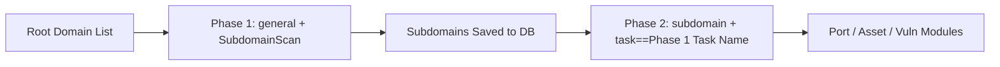

# ScopeSentry MCP User Guide

For users with a **deployed ScopeSentry instance**. Connect to the platform through Cursor (or other MCP clients) without needing local source code.

## 1. Prerequisites

### 1.1 Verify Service Accessibility

- Default Web Interface: `http://<host>`
- MCP Endpoint: `http://<host>/mcp` (If behind a reverse proxy or frontend proxy, use the actual `/mcp` URL)

### 1.2 Create API Key

1. Log in to the ScopeSentry Web UI in your browser.
2. Go to the **API Key** management page to create a key (or create via the administrator API).
3. Save the returned `ssk_...` token (**displayed only once**).

### 1.3 Configure Cursor MCP

Cursor → Settings → MCP → Add server:

```json
{
  "mcpServers": {
    "scopesentry": {
      "url": "http://<your-host>:8082/mcp",
      "headers": {
        "X-API-Key": "ssk_your_key"
      }
    }
  }
}
```

You can also use: `Authorization: Bearer ssk_your_key`

After configuration, restart MCP or reload Cursor, and verify that tools like `list_projects`, `list_assets`, etc., appear in the tool list.

---

## 2. Tool Overview

| Tool | Purpose |
| --- | --- |
| `list_projects` | Project tree grouped by tag (includes project IDs) |
| `list_projects_data` | Paginated project list, searchable by name |
| `get_project` | Project details |
| `create_project` | Create project; replaces asset scope if name matches and scope is valid |
| `list_tasks` | Scan task list |
| `get_task` | Task details |
| `list_scan_templates` | Scan template list |
| `get_scan_template` | Template details |
| `list_plugin_modules` | Pipeline module names |
| `list_plugins` | Available plugins (including hash and default parameters) |
| `create_scan_template` | Create scan template |
| `create_scan_task` | Create scan task |
| `list_assets` | Query various assets (paginated list) |
| `count_assets` | Count total assets (`/api/assets/common/total`) |
| `get_asset_detail` | Asset or vulnerability details |
| `add_asset_tag` | Add tag to asset |
| `list_nodes` | Scan node list |

Tool parameters follow each tool's MCP schema description. `list_assets` and `count_assets` share the same `search` and `filter` syntax; refer to the `list_assets` description before querying assets.

Use `count_assets` when you need the total count (maps to the Web pagination total endpoint), without paginating through `list_assets`.

---

## 3. Common Workflows

### 3.1 Query Assets by Project

When a project context **already exists**, pass `filter.project` to narrow the query scope and avoid slow responses from cross-project scans. If there is no specific project context, project filtering is not required.

1. Use `list_projects` or `list_projects_data` to get the target project's **ObjectID** (`id` / `children[].value`).
2. Pass `filter.project` to `list_assets` (**must be an ObjectID, not the project name**).

```json
{
  "asset_type": "asset",
  "pageIndex": 1,
  "pageSize": 20,
  "search": "domain=^example.com",
  "filter": {
    "project": ["<Project_ObjectID>"]
  }
}
```

### 3.2 Create Scan Task

1. Call `list_nodes` to get online node names.
2. Call `list_scan_templates` or `create_scan_template` to get the template **ObjectID**.
3. Call `create_scan_task`: `name` and `node` are required; `template` must be the template ID (not the template name).

**Target Sources `targetSource` (aligned with Web UI):**

| targetSource | Description | Required Parameters |
| --- | --- | --- |
| `general` | Direct target input | `target` |
| `project` | Read targets from project | `project` (Array of project ObjectIDs) |
| `asset` | Search from Web asset library | `search`; optional `project`, `filter`, `targetNumber` |
| `RootDomain` | Search from root domain library | `search`; optional `project`, `filter`, `targetNumber` |
| `subdomain` | Search from subdomain library | `search`; optional `project`, `filter`, `targetNumber` |
| `UrlScan` | Search from URL scan results | `search`; optional `project`, `filter`, `targetNumber` |
| `*Source` (e.g. `subdomainSource`) | Create from asset page "select/search" | When `targetTp=search`, use `search`; when `targetTp=select`, use `targetIds` |

**Example — Direct root domain scan:**

```json
{
  "name": "example-subdomain-discovery",
  "node": ["node-1"],
  "template": "<Template_ObjectID>",
  "targetSource": "general",
  "target": "example.com\nfoo.com",
  "project": ["<Project_ObjectID>"]
}
```

**Example — Follow-up scan from subdomain library (filtered by previous task name):**

```json
{
  "name": "example-ports-and-vulns",
  "node": ["node-1"],
  "template": "<Next_Stage_Template_ObjectID>",
  "targetSource": "subdomain",
  "search": "task==\"example-subdomain-discovery\"",
  "project": ["<Project_ObjectID>"]
}
```

### 3.3 Full Root Domain Reconnaissance (Recommended Two-Phase)

When the input is a **root domain** and **full reconnaissance** is needed, split into two separate scans instead of running the entire pipeline at once.

**Reason:** Distributed tasks are dispatched per **individual target**. When a root domain is dispatched to a node, subdomains discovered on that node continue executing subsequent modules on the same node. This causes uneven load distribution, slower execution, and increased failure rates.

**Best Practice:**

1. **Phase 1 — Subdomain Discovery Only**
   - `targetSource`: `general`
   - `target`: All root domains (multiline)
   - Template: Enable only `SubdomainScan` and `SubdomainSecurity` (subdomain scan + subdomain takeover)
   - Use `get_task` to wait for completion

2. **Phase 2 — Subsequent Modules**
   - `targetSource`: `subdomain`
   - `search`: `task=="<Phase 1 Task Name>"` (exact match)
   - Optional `project` to narrow scope
   - Template: Port scan, asset mapping, vulnerability scan, etc. (omit SubdomainScan)
   - Subdomains are dispatched as independent targets across nodes for higher parallel efficiency

You can also filter by task name in the Web UI "Subdomain" asset page and click "Create Task from Subdomains" for the exact same result.



### 3.4 Create Scan Template

1. `list_plugin_modules` → List of module names
2. `list_plugins` (filter by `module` if needed) → Plugin `hash` and default `parameter`
3. `create_scan_template`: Use `modules` to specify "module → plugin hash array"

---

## 4. Asset Queries (`list_assets` / `count_assets`)

`count_assets` and `list_assets` share the same `asset_type`, `search`, and `filter` parameters, returning `{ "total": N }` (maps to Web `/api/assets/common/total`).

```json
{
  "asset_type": "subdomain",
  "search": "task==\"task_name\"",
  "filter": {"project": ["<Project_ObjectID>"]}
}
```

**Performance Tips (for `list_assets` / `count_assets`):** Always use `filter.project` when project context exists. For indexed fields in `search`, use `==` exact match or `^` prefix match (see [4.3](#43-search-expression-dsl)) to avoid slow unindexed regex scans with `=`. Project filter is not required when no project context exists.

See table in [4.4](#44-filter-exact-filtering) for types supporting `filter.project`.

### 4.1 Asset Types `asset_type`

`asset`, `RootDomain`, `subdomain`, `app`, `mp`, `UrlScan`, `SensitiveResult`, `DirScanResult`, `crawler`, `vulnerability`, `PageMonitoring`, `IPAsset`, `SubdomainTakerResult`

Aliases: `web` → asset, `vuln` → vulnerability, `ip` → IPAsset, `url` → UrlScan

### 4.2 Parameter Reference

| Parameter | Description |
| --- | --- |
| `pageIndex` / `pageSize` | Pagination, defaults to 1 / 20 |
| `search` | Search expression DSL (see below) |
| `filter` | Exact filter JSON (see below) |
| `sort` | Only UrlScan and DirScanResult support sorting by `length` |
| `sid` | Only SensitiveResult: sensitive rule name |

`search` and `filter` **can be used together**.

### 4.3 Search Expression DSL

Custom DSL (**not SQL**):

| Operator | Meaning | Indexed | Example |
| --- | --- | --- | --- |
| `=` | Fuzzy match (regex) | No index | `domain=example` |
| `==` | Exact match (equals) | **Indexed** | `port==443` |
| `!=` | Exclusion | — | `port!="80"` |
| `&&` | AND | — | `domain==example.com && port==443` |
| `\|\|` | OR | — | `title=admin \|\| body=login` |

**Indexes and Operators:** Fields like `domain`, `ip`, `port`, `title` are indexed, but only **`==` exact match** or **values prefixed with `^`** (e.g. `domain=^example.com`) hit indexes. Bare **`=` converts to a regex scan and cannot use indexes**, causing high latency on large datasets.

**Universal search fields across all types:** `tag`, `task` (task name), `rootDomain`

**Do not put project in `search`** (ignored or triggers syntax errors with `&&`). Use `filter.project` instead.

**Common search fields by type:**

| asset_type | Fields |
| --- | --- |
| asset | domain, ip, port, service, app, title, statuscode, icon, banner, type, body, header |
| RootDomain | domain, icp, company |
| subdomain | domain, ip, type, value |
| app | name, icp, company, category, description, url, apk |
| mp | name, icp, company, category, description, url |
| UrlScan | url, input, source, resultId, type |
| SensitiveResult | url, sname, body, info, md5 |
| DirScanResult | url, statuscode, redirect, length |
| vulnerability | url, vulname, matched, request, response, level |
| crawler | url, method, body, resultId |
| PageMonitoring | url, hash, diff, response |
| IPAsset | ip, domain, port, service, webServer, app |
| SubdomainTakerResult | domain, value, type, response |

**Search Examples:**

- `domain==www.example.com && port==443` (exact, indexed)
- `domain=^example.com` (prefix match, indexed)
- `ip==192.168.1.1`
- `task=="task_name"`
- `level==high` (vulnerability)
- `statuscode==200` (DirScanResult)

Use `=` only when fuzzy matching is strictly required, e.g. `title=admin` (unindexed, combine with project filter).

### 4.4 Filter (Exact Filtering)

JSON object: Multiple values for the same key act as **OR**; different keys act as **AND**.

**Prioritize `project` when available:** If project is known and `asset_type` supports `project`, include it to restrict search space; not required if no project context exists.

| filter key | Meaning | Value Details |
| --- | --- | --- |
| `project` | Belonging project | **ObjectID**, from `list_projects` / `list_projects_data` |
| `task` | Source task | **Task name**, from `name` in `list_tasks` |
| `port` | Port | E.g. `"443"` |
| `service` | Service / protocol | E.g. `"https"` |
| `app` | Application fingerprint | E.g. `"Nginx"` |
| `icon` | Favicon hash | |
| `statuscode` | HTTP status code | Mainly for asset |
| `status` | Status | UrlScan/DirScan HTTP status; vuln/sensitive review status |
| `level` | Vulnerability severity | critical / high / medium / low / info |
| `type` | Type | E.g. subdomain DNS record type (A, CNAME) |
| `color` | Sensitive rule color | SensitiveResult |
| `sname` | Sensitive rule name | SensitiveResult |
| `tags` | Tags | |

**Supported filter keys per type:**

| asset_type | filter key |
| --- | --- |
| asset | project, port, service, app, icon, statuscode, type, task, tags |
| RootDomain | project, tags |
| subdomain | project, type, task, tags |
| app / mp | project, tags |
| UrlScan | status, tags |
| DirScanResult | status, tags |
| SensitiveResult | status, color, sname, tags |
| crawler | project, task, tags |
| vulnerability | project, level, status, task, tags |
| PageMonitoring / SubdomainTakerResult | tags |
| IPAsset | project, port, service, app |

**Filter Example:**

```json
{"project": ["<Project_ObjectID>"], "port": ["443"]}
```

**Combined Query Example:**

```json
{
  "asset_type": "asset",
  "search": "domain=^baidu && port==443",
  "filter": {"project": ["<Project_ObjectID>"]},
  "pageIndex": 1,
  "pageSize": 10
}
```

**Notes:**

- Add `filter.project` when project context exists (if supported); optional otherwise.
- Never put project display names in `filter.project`.
- Prefer `==` for known values and `^` for prefixes; avoid fuzzy `=` on large collections.
- For UrlScan HTTP status, use `filter.status`; for DirScanResult, use `statuscode==200` in search.
- Filter SensitiveResult by rule name: use `sname=rule_name` in `search`, or `filter.sname`.

### 4.5 Sorting `sort`

Supported only by **UrlScan** and **DirScanResult**:

```json
{"length": "ascending"}
```

Other types ignore `sort` and default to chronological ordering.

---

## 5. Scan Template Module Names

`TargetHandler`, `SubdomainScan`, `SubdomainSecurity`, `PortScanPreparation`, `PortScan`, `PortFingerprint`, `AssetMapping`, `AssetHandle`, `URLScan`, `WebCrawler`, `URLSecurity`, `DirScan`, `VulnerabilityScan`, `PassiveScan`

---

## 6. Troubleshooting

| Symptom | Resolution |
| --- | --- |
| No MCP tools shown | Check URL, API Key, and ensure ScopeSentry server is running |
| 401 / 403 Unauthorized | Re-create or rotate the API Key |
| Asset query returns empty | Verify `filter.project` is an ObjectID; do not put project in `search` |
| Template / Task creation fails | `template` must be template ObjectID; `node` must be an online node name |
| Query slow or hanging | Add `filter.project`; in search use `==` or `^` prefix instead of `=`; reduce `pageSize` |

---
